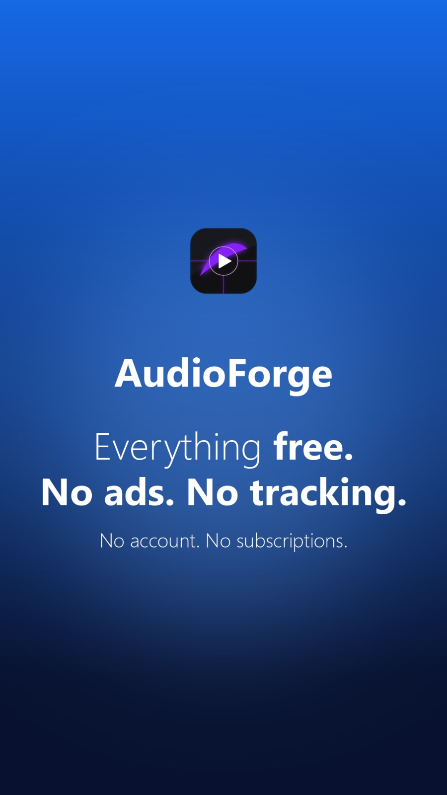
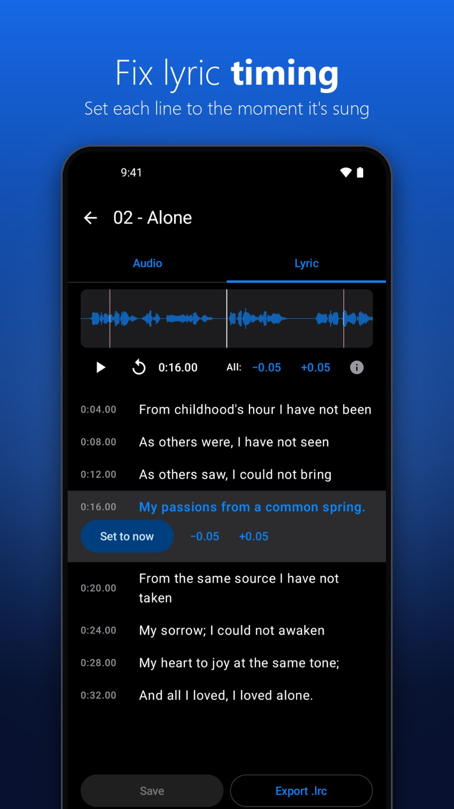
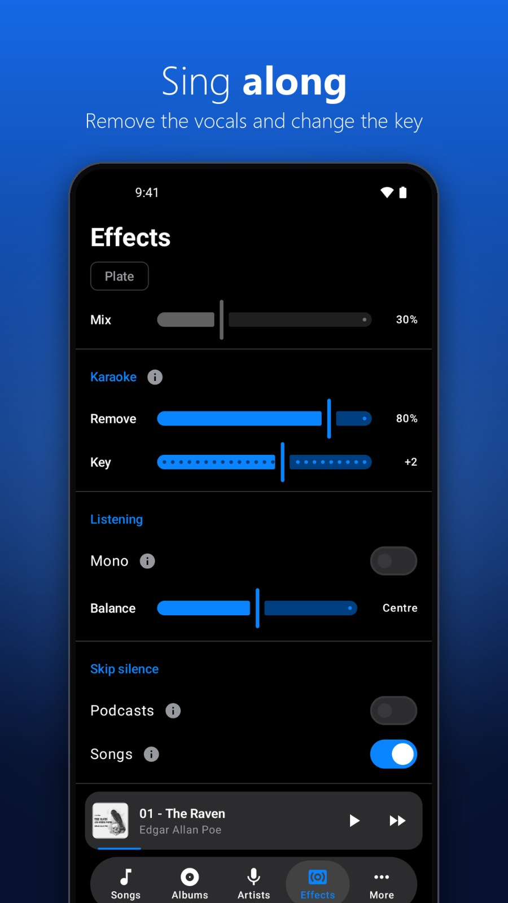
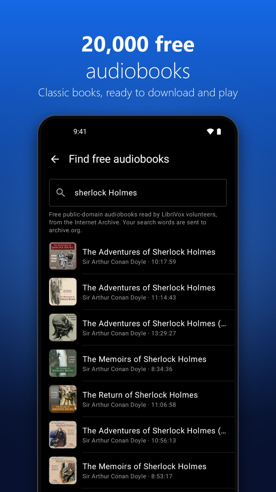
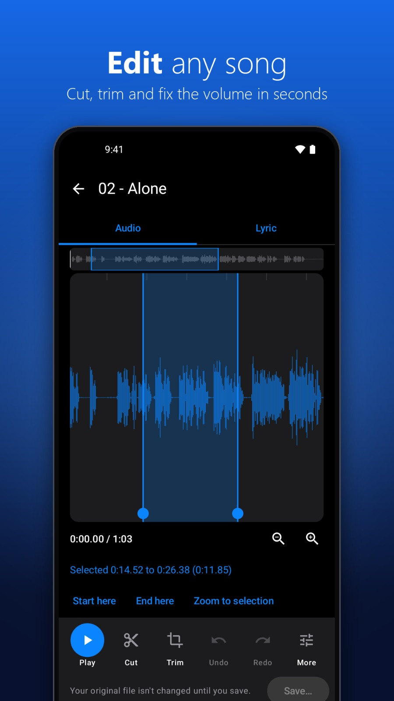
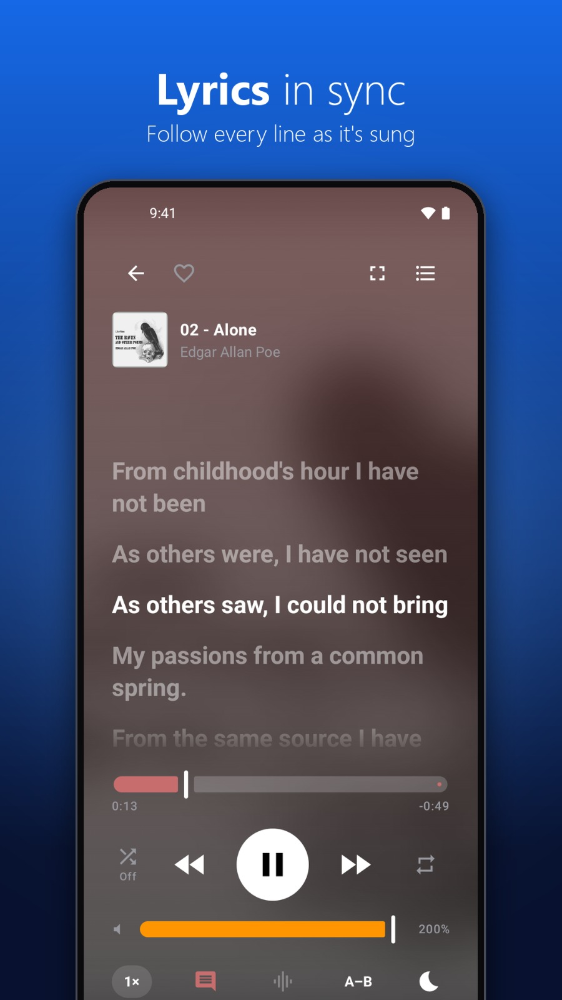
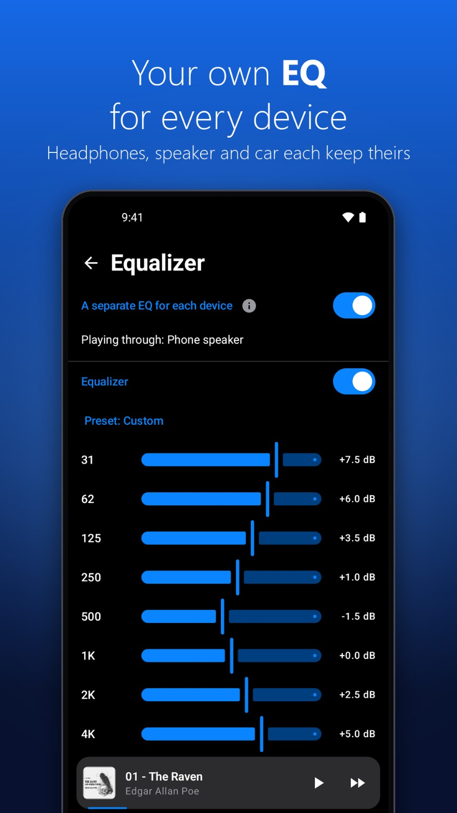
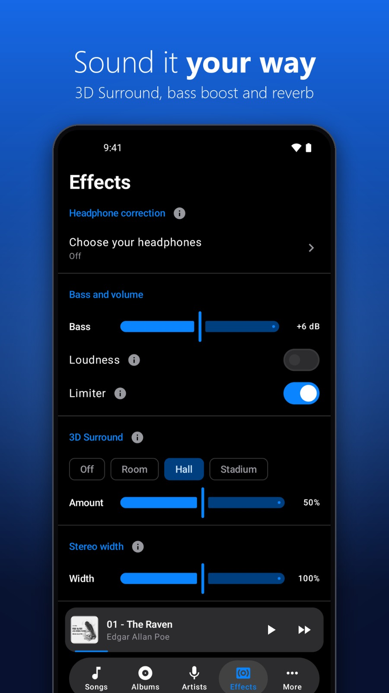

# AudioForge

<p>








</p>

A Qt-based MP3 player/library manager: playback (with crossfade),
tag-based library browsing (Albums/Tracks/Artists), playlists, ReplayGain,
a 10-band equalizer, MusicBrainz and manual tag editing, cover art editing,
synced lyrics (LRCLIB / Musixmatch / local .lrc), per-track video
wallpapers, and Discord Rich Presence. The interface is in English, Français,
简体中文, 繁體中文 and Bahasa Melayu, and Settings > About has an update check
against the GitHub releases.

Also, like the Android app: Loved songs (the heart on Now Playing) and play
counts; smart playlists (rules like "genre contains Rock and year is more
than 2010", plus the built-in Loved / Most Played / Recently Played /
Recently Added / Never Played); .m3u import and export; a per-song lyrics
timing offset; a Now Playing visualizer with ten styles in the cover's
colours (chosen from live previews in Settings), or a custom GIF or looping video; and offline genre detection
(Google's YAMNet model, run with ONNX Runtime) with "Fill Genre from
analysis" in the tag editor. A smarter duplicate finder (similar names like
"01 - Song" / "Song - 2011 Remaster", "Not duplicates" with Undo, several
copies to the Recycle Bin at once); A–B repeat on Now Playing; and a
Podcasts tab: tick Podcast for a folder in the Folders tab and its episodes
(.mp3, and .m4a/.m4b/.aac through FFmpeg) show there only, grouped by show,
newest first, resuming where they were left and marked played near the end.

On Windows it also works with the system: the song and cover show in Windows'
media controls (volume overlay, lock screen) and the keyboard's media keys work
in the background; the taskbar preview has Previous / Play / Next and the icon
shows the progress; a tray icon has the playback controls (optionally keeping
the music going when the window is closed), and an optional notification
announces each new song. Music files dropped on the window play; dropped
folders join the library.

Version: **1.4.0** (set in `CMakeLists.txt`; desktop releases are tagged with
the plain number, e.g. `1.4.0`, which the update check compares with).

## Structure

```
audioforge/
├── CMakeLists.txt
├── README.md
├── resources/                   # app icon (.png for Qt, .ico/.rc for the Windows .exe),
│                                # i18n/*.json translations, about/*.md Terms & Privacy pages,
│                                # models/ genre detection's YAMNet model (scripts/convert_yamnet.py)
├── scripts/                     # deploy_windows.sh, build_installer.sh, i18n_check.py, convert_yamnet.py
├── installer/                   # audioforge.iss (Inno Setup script for the Windows installer)
├── android/                     # Android app (Kotlin + Compose), see "Android app" below
├── ios/                         # iPhone app (SwiftUI), see ios/AudioForge/README.md
├── vendor/
│   └── miniaudio.h              # third-party, single-header audio library
│
├── common/                      # UI-agnostic core (Qt Core/Network; no custom widgets)
│   ├── include/audioforge/
│   │   ├── track_info.hpp       # TrackInfo / PlaylistData structs
│   │   ├── wallpaper_data.hpp   # WallpaperEntry struct
│   │   ├── audio_engine.hpp     # miniaudio wrapper (playback + crossfade + EQ)
│   │   ├── playback_queue.hpp   # shuffle / repeat / history logic
│   │   ├── discord_presence.hpp # Discord Rich Presence over local IPC
│   │   ├── secret_store.hpp     # protects stored API keys (DPAPI on Windows)
│   │   ├── warnings.hpp         # ErrorReporter (warn/info/confirm + log file)
│   │   ├── app_info.hpp         # version, GitHub/support links, User-Agent
│   │   ├── translations.hpp     # interface language (loads resources/i18n/*.json)
│   │   ├── update_checker.hpp   # Settings > About > Version: newer release on GitHub?
│   │   ├── m3u.hpp              # .m3u/.m3u8 reading, matching to the library, writing
│   │   ├── visualizer_tap.hpp   # spectrum of what's playing, for the visualizer
│   │   ├── genre.hpp            # genre detection (YAMNet via ONNX Runtime)
│   │   └── ffmpeg_audio.hpp     # AAC/M4A decoding for the audio engine (FFmpeg)
│   └── src/
│       ├── main.cpp             # entry point
│       └── ...                  # one .cpp per header above
│
└── qt_player/                   # everything Qt-widget/TagLib specific
    ├── include/audioforge/
    │   ├── player_window.hpp    # main window
    │   ├── music_library.hpp    # folders/tracks/playlists
    │   ├── wallpaper_library.hpp# video wallpaper assignments (wallpapers.json)
    │   ├── track_metadata.hpp   # TagLib read/write (basic tags, ReplayGain, cover art)
    │   ├── track_metadata_tags.hpp # TagLib read/write of every tag (manual editor)
    │   ├── cover_art_writer.hpp # replaces embedded cover art
    │   ├── lyrics_provider.hpp  # .lrc parsing, sidecar + cached lyrics
    │   ├── widgets/             # clickable / click-to-seek / video background / stacked widgets
    │   └── dialogs/             # track list, playlists, MusicBrainz, manual tags, wallpaper picker
    └── src/  (mirrors the above)
```

## Building (Windows, MSYS2 UCRT64 + VS Code)

Requires (installed via the MSYS2 UCRT64 terminal):
```
pacman -S mingw-w64-ucrt-x86_64-qt6-base mingw-w64-ucrt-x86_64-qt6-tools \
          mingw-w64-ucrt-x86_64-qt6-multimedia \
          mingw-w64-ucrt-x86_64-taglib mingw-w64-ucrt-x86_64-pkgconf \
          mingw-w64-ucrt-x86_64-onnxruntime mingw-w64-ucrt-x86_64-ffmpeg
```
(FFmpeg is already there as a dependency of qt6-multimedia; it's linked
directly now to play .m4a podcasts.)

Windows has its own, older `onnxruntime.dll` in System32, which Windows loads
before one on PATH. The build copies MSYS2's next to `audioforge.exe` (and
`deploy_windows.sh` into the installer folder) so the right one is used; if
the wrong one is loaded anyway, genre detection just reports failure.

Then in VS Code: **CMake: Select a Kit** (the MSYS2 UCRT64 GCC kit) →
**CMake: Configure** → **CMake: Build**.

To check a page's look without clicking through the app, set
`AUDIOFORGE_SNAPSHOT` (pages separated by `;`, each a tab index or
`nowplaying`, a colon, and an image file) and run it, e.g. with
`QT_QPA_PLATFORM=offscreen`: `AUDIOFORGE_SNAPSHOT="4:playlists.png;nowplaying:np.png"`.
It saves those pages a few seconds after start and quits without saving anything.

## Deploying on Windows (machines without MSYS2/Qt)

From the MSYS2 UCRT64 shell, after building:
```
scripts/deploy_windows.sh build/audioforge.exe dist
```
This produces a `dist/` folder that runs on a clean Windows install. It runs
`windeployqt6 --release`, adds the QtMultimedia FFmpeg backend
(`multimedia/ffmpegmediaplugin.dll`), writes `qt.conf` (`Plugins = .`), and then
copies every DLL that anything in the folder still loads from `/ucrt64/bin`.
It repeats that until nothing is missing.

`windeployqt6` alone isn't enough. It copies the Qt DLLs and plugins, but not
the DLLs those plugins depend on. The FFmpeg backend alone needs about 80
codec and support libraries (avcodec, libx264, libvpx, gnutls, cairo, ...).
When they're missing, the app starts but logs
`No QtMultimedia backends found` and the video wallpaper can't play.

Notes:
- On MSYS2's Qt 6 the plugin folder is `multimedia/`, not `mediaservice/`
  (the older Qt 5 name).
- To check a folder by hand, run this from inside it. It should print nothing:
  `ldd multimedia/ffmpegmediaplugin.dll | grep /ucrt64/bin/`

## Building (Linux)

Debian/Ubuntu packages:
```
sudo apt install cmake g++ pkg-config qt6-base-dev qt6-multimedia-dev libtag1-dev \
                 gstreamer1.0-plugins-base gstreamer1.0-plugins-good
cmake -B build && cmake --build build
```
The GStreamer plugins are needed at runtime by Qt Multimedia (video wallpaper).

## Android app


`android/` is a Kotlin port of the desktop app. It now has the same features as the
iOS app (see below), home-screen widgets included; Android Auto takes CarPlay's place.
It was built in stages:

1. Project setup. **Done.**
2. Playback, library, queue, playlists. **Done:** the phone's music library plus
   added folders (phone-library folders can be hidden, e.g. WhatsApp audio), the Tracks/Albums/Artists/Folders/Playlists/Settings tabs,
   background playback with notification and lock-screen controls, and the
   desktop's shuffle, repeat and history logic.
3. Crossfade, equalizer, ReplayGain. **Done:** two-player crossfade (2–15 s),
   the desktop's 10-band EQ with presets and post-gain (applied in the audio
   pipeline, so it's the same on every phone), ReplayGain from MP3, FLAC,
   OGG/Opus and M4A tags, and volume up to 200%.
4. Tag and cover editing. **Done:** long-press a song (in any list, or the
   cover on Now Playing) for **Edit tags** / **Change cover**. Both are written
   into the file with jaudiotagger (MP3, FLAC, OGG Vorbis, M4A, WAV); covers
   over 1200 px are scaled down first. Android asks before changing
   phone-library songs; added folders need write access once. (The desktop's
   MusicBrainz lookup wasn't ported.)
5. Lyrics. **Done:** cache, then LRCLIB, then Musixmatch (with an API key,
   stored encrypted with the Android Keystore), then a same-name .lrc/.txt
   next to the track in an added folder; synced highlighting and tap-to-seek.
   LRCLIB is tried with several searches (exact, without "(Live)"-style
   suffixes, general search, artist/title split from the file name) and the
   result matching the song's length is preferred.
6. Video wallpapers and settings. **Done:** a global video plus per-song
   videos behind Now Playing (first matching assignment wins, like the
   desktop), muted and looping, paused in the background; on/off and opacity
   in Settings.
7. iOS parity. **Done:** the iOS tab bar (Songs, Albums, Artists, Genres,
   Folders, Playlists, Equalizer, Wallpapers, Settings, with "More" past five);
   Play next / Add to queue and an Up Next page (history, reorder, remove,
   Save as playlist), remembered across launches; gapless playback; speed,
   sleep timer (with fade-out), A–B repeat, ±15 s and resume for long tracks;
   play counts, Loved songs, smart lists and rule-based smart playlists,
   .m3u import/export, playlist covers; multi-select, import and delete, A–Z
   index, duplicate finder; full-screen word-by-word lyrics with a timing
   offset, the lyric line on the lock screen, a visualizer and cover colours
   on Now Playing; key/BPM analysis with Smart Transitions, Beat-Matched
   Crossfades and Harmonic Shuffle; Android Auto (browse the library, Lyrics
   list).
8. Home-screen widgets. **Done:** eight styles, all free (Mini, Lite, Classic,
   Simple, Standard, Stylish, Practical, Feature-Rich), each its own entry in
   the launcher's widget picker; **Settings → Widgets** shows them with live
   previews and an **Add** button. Each widget's background is cover colours,
   black or translucent.
9. Listening stats. **Done:** **Settings → Listening stats** shows time
   listened, plays, and top songs, artists, albums and genres per month, per
   year or for all time (podcasts counted separately), from a play log kept on
   the phone (a play counts after 30 s, or half a short song). A year can be
   shared as an "AudioForge Year in Review" image.
10. Podcast search and download. **Done:** search Apple's podcast directory,
    subscribe, see a show's episodes from its RSS feed, "Check for new
    episodes", and download episodes (Android's download manager, saved
    unchanged in the phone's Podcasts folder, where they show up as episodes).
11. Internet radio. **Done:** a Radio tab with tens of thousands of stations
    from Radio Browser (ported from the desktop World_Radio): search by name
    or tag, filter by country, Top stations, Favorites and Recently played.
    Stations play through the same player (EQ, effects, sleep timer,
    notification, Android Auto), including HLS streams, with the station's
    "now playing" title on Now Playing and the lock screen.

Code layout (`android/app/src/main/java/com/biasnil/audioforge/`):
```
AppContainer.kt          # app-wide objects (store, library, player, lyrics...); restores the queue
MainActivity.kt          # Compose entry point; starts PlaybackService
playback/
  PlaybackManager.kt     # two ExoPlayers: crossfade, gapless, beat-match, speed, sleep timer, A–B
  PlaybackQueue.kt       # queue, shuffle (Off/Random/Smart), repeat, history, Play next / Up Next edits
  QueueStore.kt          # queue + position saved between launches (files/queue.json)
  PlaybackService.kt     # media session (notification, lock screen) and Android Auto browsing
  QueueForwardingPlayer.kt # adds next/previous and the lyric line to the media session
audio/
  AudioEffectsProcessor.kt, Equalizer.kt # EQ + gain inside each player's audio pipeline
  AudioDecoder.kt        # decode part of a file to mono floats at a chosen rate (MediaCodec)
  AudioAnalyzer.kt, AnalysisMath.kt      # decode a song and find BPM, beats, key, silence, outro
  LibraryAnalyzer.kt     # runs the analysis over the library (background only while charging)
  GenreClassifier.kt, GenreWindow.kt     # on-device genre detection (YAMNet via LiteRT)
  GenreAnalyzer.kt       # runs genre detection over the library, like LibraryAnalyzer
  Visualizer.kt          # spectrum for Now Playing
data/
  AppStore.kt            # settings + playlists (files/audioforge.json)
  LibraryRepository.kt   # the library: MediaStoreSource (phone) + FolderSource (added folders)
  Track.kt, TrackTags.kt, LibraryModel.kt # song model, tag reading, grouping/sorting/search
  SongData.kt            # play counts, Loved, long-track positions, lyrics offsets
  PlayLog.kt, ListeningStats.kt # listening log (files/playlog.jsonl) and Listening stats totals
  Analysis.kt            # analysis results, MusicKey (Camelot), harmonic order
  Genre.kt, GenreTaxonomy.kt # detected genres (files/genre.json), YAMNet labels -> genre/subgenre
  SmartPlaylists.kt      # smart playlist rules
  DuplicateFinder.kt     # duplicate detection; DuplicateDismissals.kt keeps "Not duplicates"
  UpdateChecker.kt, Acknowledgements.kt  # Settings -> About
  Podcasts.kt            # podcast folders: which songs are episodes, grouping into shows
  PodcastFeeds.kt, PodcastRepository.kt # podcast search (iTunes Search API), RSS feeds, subscriptions, downloads
  RadioBrowser.kt, RadioRepository.kt   # internet radio: Radio Browser directory, mirrors, favorites, recent
  CustomMedia.kt         # visualizer styles; GIFs / videos per song (Settings -> Visualizer)
  CoverArtLoader.kt, WallpaperRepository.kt, SecretBox.kt (Keystore-encrypted API key)
lyrics/                  # LRCLIB / Musixmatch / local .lrc lookup and parsing; LyricLineTracker
                         # follows the line being sung (lock screen, Android Auto)
tags/                    # tag and cover writing (jaudiotagger)
widget/                  # home-screen widgets: WidgetModel.kt (styles, what each shows), WidgetRenderer.kt
                         # (RemoteViews), WidgetUpdater.kt (redraws on playback changes), the providers
ui/                      # Compose screens: one file per tab or page; Common.kt (shared rows,
                         # buttons) and Bars.kt (top bar, tab bar, ⋮ menu) are shared by them
```

Requirements: Android 12+ (minSdk 31), targeting API 36. The only native code
is LiteRT (genre detection) and a small Compose library, all 16 KB aligned, so
the app runs on both 4 KB and 16 KB memory page size devices. The YAMNet model
(`app/src/main/assets/yamnet.tflite`, Apache 2.0) is committed;
`android/scripts/fetch_yamnet.sh` re-downloads it and checks its SHA-256, and
`android/scripts/check_yamnet.py` prints its inputs and outputs.

To build, open the `android/` folder in Android Studio (**File → Open**), let
Gradle sync, then run the `app` configuration. It uses Kotlin, Jetpack Compose,
Gradle 8.14.3 (through the included wrapper) and Android Gradle Plugin 8.11.1.

The app has two build flavors that differ only in the update check
(Settings → About → Version): `github`, with the check, and `play`, without it,
since Play doesn't allow pointing users at updates from elsewhere. In Android
Studio pick one under **Build → Select Build Variant**.

Releasing on GitHub: `./gradlew assembleGithubRelease`, tag the release
`Androidv<versionName>`, exactly matching `versionName` in
`android/app/build.gradle.kts` (for example `Androidv1.4.1`), and attach the
APK. The update check only looks at `Androidv*` releases, so desktop releases
don't affect it.

Releasing on Google Play: `./gradlew bundlePlayRelease` and upload the `.aab`.
Raise `versionCode` for every release. What changed in each version is in
[`android/CHANGELOG.md`](android/CHANGELOG.md). To sign release builds, copy `android/keystore.properties.example`
to `android/keystore.properties` (gitignored) and fill it in.

## iOS app

`ios/AudioForge/` is a SwiftUI app for iPhone (iOS 17+) with the same features as
the Android app. Playback runs on AVAudioEngine, which gives crossfade, the 10-band EQ
with presets and post-gain, ReplayGain and volume up to 200%. The app also has
Off/Random/Smart shuffle with play history, a tag and cover editor (MP3, FLAC, M4A),
lyrics from LRCLIB and Musixmatch with plain lyrics and a cache, and folders linked
from the Files app (subfolders included). The rest of the Android features are there
too: video wallpapers, a Settings tab and hideable tabs. The home screen Now Playing
widget is iOS-only for now. See `ios/AudioForge/README.md` for the Xcode setup and the
list of source files.

## Translations

Interface text is written in English in the code, inside `tr("...")` (or
`Tr("...")` outside a QObject). `resources/i18n/<code>.json` maps each English
string to its translation (`fr`, `zh_Hans`, `zh_Hant`, `ms`); a string that's
missing just shows in English. The Terms and Privacy pages are
`resources/about/{terms,privacy}_<code>.md`. After changing interface text, run:
```
python scripts/i18n_check.py
```
It lists, per language, strings that are missing, entries no longer used, and
translations whose `%1`/`%2` placeholders don't match. `--keys` prints every
English string as a JSON template for a new language (add the language to
`LanguageOptions()` in `common/src/translations.cpp` and to `resources/text.qrc`).

## Settings

Stored at `%APPDATA%\AudioForge\AudioForge.ini` (on Linux,
`~/.config/AudioForge/AudioForge.ini`): theme, language, volume, crossfade, equalizer,
music folders, playlists, visible tabs, and integration settings (smart
playlists are in `smartplaylists.json`, play counts / Loved / lyrics offsets
in `songstats.json`, detected genres in `genre.json`, the visualizer's GIFs
and videos in `visualizer_media.json`, "Not duplicates" pairs in
`duplicate_dismissals.json`, all next to it). The
Musixmatch API key is encrypted with Windows DPAPI (tied to your Windows
account); on other platforms it's stored as-is. Video wallpaper assignments
live in `wallpapers.json` next to it, and warnings/errors are logged to
`warnings.log` in the app data folder.

## License

AudioForge is free software under the GNU General Public License v3.0 (see
`LICENSE`): use it, change it and share it, as long as what you share stays
GPL-3.0 with its source. Libraries it uses keep their own licences (listed in
each app's Acknowledgements).
